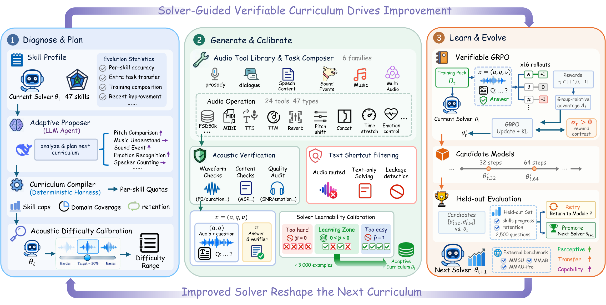
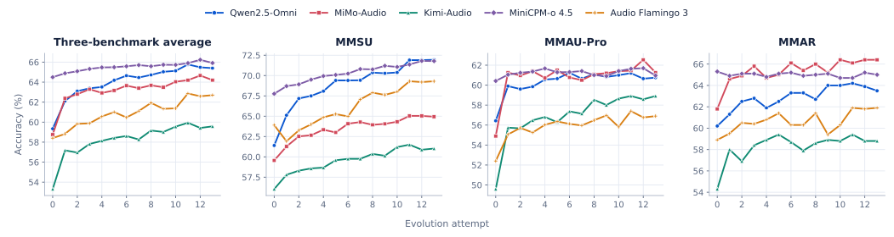

<div align="center">
  <h1>
    <picture>
      <source media="(prefers-color-scheme: dark)" srcset="assets/evoaudio-wordmark-dark.png">
      
    </picture>
  </h1>
  <h3>Recursive Self-Improvement for Audio Understanding</h3>
  <p>Adaptive curricula · Verifiable audio · Recursive improvement</p>
  <p>
    <a href="https://arxiv.org/abs/2609.27389"></a>
    &nbsp;
    <a href="https://jensenyx.github.io/EvoAudio.github.io/"></a>
    &nbsp;
    <a href="LICENSE"></a>
  </p>
  <p><strong>English</strong> &nbsp;·&nbsp; <a href="README_zh.md">简体中文</a></p>
  <p>
    <a href="#installation">Installation</a> &nbsp;·&nbsp;
    <a href="#quickstart">Quickstart</a> &nbsp;·&nbsp;
    <a href="#run-self-evolution">Training</a> &nbsp;·&nbsp;
    <a href="#evaluation">Evaluation</a> &nbsp;·&nbsp;
    <a href="#paper-results">Results</a> &nbsp;·&nbsp;
    <a href="#citation">Citation</a>
  </p>
</div>

---

EvoAudio builds the next training curriculum around the current audio model: it chooses skills to practise, adjusts acoustic difficulty, constructs audio questions with verifiable answers, and updates the model with GRPO. A candidate becomes the next solver when it improves on a fixed held-out set.

This repository provides data generation, curriculum planning, GRPO training, and evaluation for Qwen2.5-Omni-7B.

<p align="center">
  <a href="https://jensenyx.github.io/EvoAudio.github.io/#demos">
    
  </a>
  <br>
  <sub>Explore the framework, then <a href="https://jensenyx.github.io/EvoAudio.github.io/#demos">listen to the audio demos</a>.</sub>
</p>

## How it works

1. **Diagnose and plan.** Measure accuracy by skill and use recent progress and training reward variation to set curriculum quotas and difficulty.
2. **Generate and verify.** Synthesize speech, render MIDI, or load recordings, then control pitch, speed, loudness, and timing. Construction records determine the answers, independent measurements check the finished waveforms, and Whisper verifies synthesized speech content.
3. **Select and learn.** Remove questions answered without audio. Sample four responses to each remaining candidate and train on questions answered correctly one to three times.
4. **Evaluate and evolve.** Compare candidate checkpoints with the parent on the fixed held-out set. Promote an improved candidate, or keep the parent and build a new curriculum.

## Installation

Use Linux, Python 3.12, the CUDA 12.8 toolkit, and a compatible NVIDIA driver. The quickstart training configuration uses **8 GPUs with 80 GB each**; synthesis and inference use one GPU. Allow approximately **400 GB of free disk space** for environments, model caches, audio, and two checkpoints with optimizer states.

```bash
git clone https://github.com/JensenYX/EvoAudio.git
cd EvoAudio

sudo apt-get update
sudo apt-get install -y ffmpeg sox libsndfile1 fluidsynth timgm6mb-soundfont build-essential

python3.12 -m venv .venv
.venv/bin/python -m pip install --upgrade pip
.venv/bin/python -m pip install torch==2.9.0 torchaudio==2.9.0 torchvision==0.24.0 --index-url https://download.pytorch.org/whl/cu128
.venv/bin/python -m pip install -r requirements/train.txt
.venv/bin/python -m pip install packaging ninja wheel setuptools
.venv/bin/python -m pip install flash-attn==2.8.3 --no-build-isolation

python3.12 -m venv .venv-tts
.venv-tts/bin/python -m pip install --upgrade pip
.venv-tts/bin/python -m pip install torch==2.11.0 torchaudio==2.11.0 torchvision==0.26.0 --index-url https://download.pytorch.org/whl/cu128
.venv-tts/bin/python -m pip install -r requirements/tts.txt
```

Training and TTS use separate environments, with their dependency combinations defined in the installation files. Models download from Hugging Face on first use. To use local weights, set `model`, `tts_model`, and `whisper_model` to model directories in your YAML configuration.

## Quickstart

Run from the repository root:

```bash
.venv/bin/evoaudio prepare --config configs/quickstart.yaml
.venv/bin/evoaudio generate --config configs/quickstart.yaml --count 20
.venv/bin/evoaudio evolve --config configs/quickstart.yaml
.venv/bin/evoaudio evaluate --config configs/quickstart.yaml
```

The quickstart uses a small collection of synthesized speech and MIDI audio, 20 held-out questions, and two GRPO steps. Curriculum planning uses local skill statistics and needs no API key. After training, the system reloads both checkpoints, compares their validation scores, and saves the next curriculum.

Outputs are written to `runs/quickstart/`:

| Path | Contents |
| --- | --- |
| `samples/items.jsonl`, `samples/audio/` | Independently generated questions and audio |
| `heldout/items.jsonl` | Fixed validation questions |
| `round-001/selected.jsonl` | Selected training questions and construction evidence |
| `round-001/train/checkpoints/` | Models, optimizer states, and training records |
| `round-001/decision.json` | Validation results and promotion decision |
| `round-001/next_curriculum.json` | Curriculum for the next round |
| `state.json` | Current solver and completed rounds |

Each generated item contains audio paths, a question, options, an answer, difficulty, construction records, and acoustic check results.

Inspect the commands and available tasks:

```bash
.venv/bin/evoaudio --help
.venv/bin/evoaudio tasks
```

## Run self-evolution

Copy the training configuration and set the output directory, models, and compute resources:

```bash
cp configs/qwen.yaml local.yaml
read -rsp 'DeepSeek API key: ' DEEPSEEK_API_KEY
export DEEPSEEK_API_KEY
printf '\n'
.venv/bin/evoaudio prepare --config local.yaml
.venv/bin/evoaudio evolve --config local.yaml
```

The `proposer` configuration specifies the API endpoint, model name, and environment variable containing the key. The proposer receives skill statistics and returns curriculum priorities; answers come from audio construction or source labels.

The training configuration uses:

| Parameter | Default |
| --- | --- |
| Evolution rounds | 13 |
| Training steps per round | 64 |
| Candidate checkpoints | Steps 32 and 64 |
| Prompts per step / responses per prompt | 16 / 16 |
| Learning rate | Constant `1e-6` |
| Temperature / KL coefficient | 0.9 / 0.02 |
| Fixed held-out set | 2,500 questions |
| Per-skill quota cap / retention budget floor | 6% / 12% |

Training updates the audio and language paths. Every round starts with a fresh optimizer and uses its parent as the KL reference. For multiple nodes, set `resources.hosts` to their addresses and `devices` to the GPU indices used on each node. Nodes need passwordless SSH and the same paths for the installed code, environments, and shared data. The paper used four nodes with eight H800 GPUs each.

Resume an interrupted run:

```bash
.venv/bin/evoaudio evolve --config local.yaml --resume
```

Completed generation and inference stages are reused, and training continues from a complete checkpoint. Use a new `output_dir` for a new configuration or data partition.

## Use existing recordings

Set source paths under `data` in the YAML configuration. Task generators can draw from imported recordings alongside synthesized sources.

```yaml
data:
  librispeech: data/LibriSpeech
  fsd50k: data/FSD50K
  manifest: data/recordings.jsonl
```

LibriSpeech accepts the original FLAC/transcript layout and Arrow/Parquet data. FSD50K uses `FSD50K.ground_truth/dev.csv` and `FSD50K.dev_audio/`. Import your own recordings or AudioSet recordings through JSONL, with audio paths relative to the manifest:

```jsonl
{"path":"audio/dog.wav","kind":"sound","label":"dog bark","source_id":"recording-001"}
{"path":"audio/speech.wav","kind":"speech","text":"The train leaves at nine.","source_id":"recording-002"}
{"path":"audio/piano.wav","kind":"music","source_id":"recording-003"}
```

Source recordings are assigned to training or validation by stable identifiers. You can also provide an explicit `split` of `train` or `heldout` in the manifest. Run `prepare` after setting up the manifests and audio.

## Evaluation

Evaluation uses the current solver and the fixed held-out set by default. Pass `--model` to select another checkpoint.

```bash
.venv/bin/evoaudio evaluate --config local.yaml --benchmark mmsu --data-root data/MMSU
.venv/bin/evoaudio evaluate --config local.yaml --benchmark mmau_pro --data-root data/MMAU-Pro
.venv/bin/evoaudio evaluate --config local.yaml --benchmark mmar --data-root data/MMAR
```

MMSU reads the official Arrow data, MMAU-Pro reads `test.parquet` and its audio files, and MMAR reads `MMAR-meta.json` or `MMAR-meta.jsonl`. MMAU-Pro evaluation uses closed nonspatial questions with official answers. Results under `evaluation/` include per-question predictions, overall accuracy, and category accuracy.

## Paper results

The following Qwen2.5-Omni-7B results are reported in the paper. Avg. is the mean of the three benchmark totals.

| Method | MMSU | MMAU-Pro | MMAR | Avg. |
| --- | ---: | ---: | ---: | ---: |
| Base | 61.4 | 56.4 | 60.2 | 59.3 |
| EvoAudio (GRPO) | **71.9** | **60.8** | **63.5** | **65.4** |

[](https://jensenyx.github.io/EvoAudio.github.io/#evolution)

## Citation

```bibtex
@article{wang2026evoaudio,
  title={EvoAudio: Recursive Self-Improvement for Audio Understanding},
  author={Wang, Yuxiang and Cai, Shengbo and Shen, Yingda and Hsu, Ming-Hao and Ni, Qinke and Zhang, Liqiang and Sun, Teddy and Yevs, Steve and Wu, Zhizheng},
  journal={arXiv preprint arXiv:2609.27389},
  year={2026}
}
```

## License

Code is released under [Apache-2.0](LICENSE). Models, datasets, and SoundFonts retain their respective licenses.

